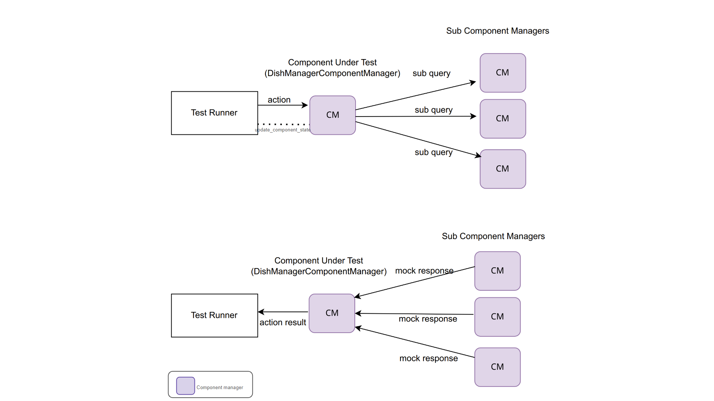
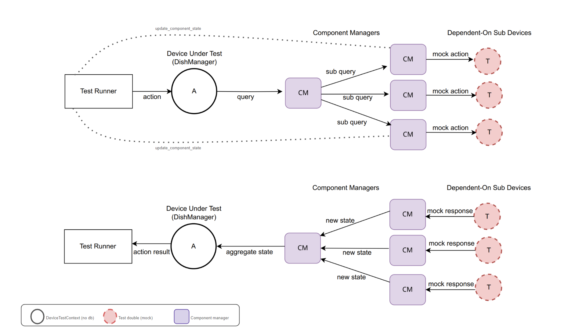
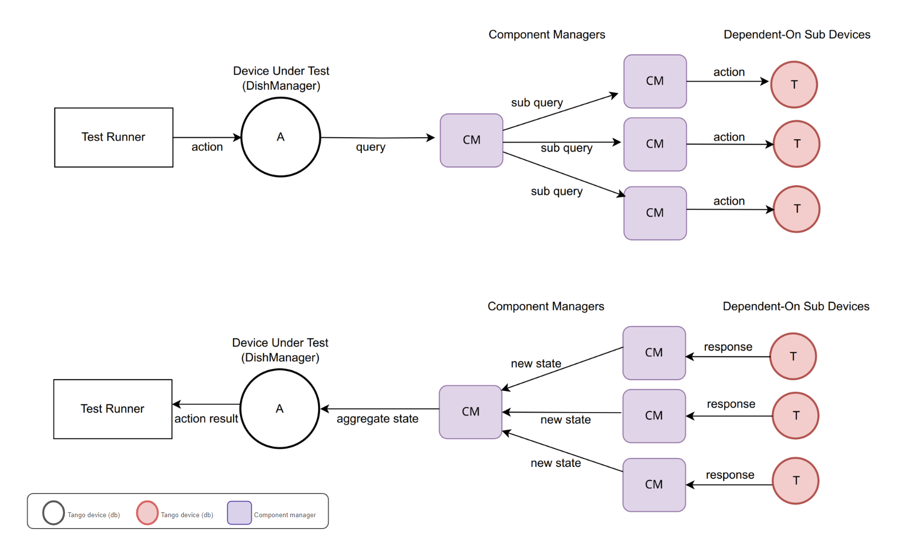

=======
Testing
=======

Unit Tests
^^^^^^^^^^

Since the component managers handle the interactions with the devices, we are
able to check the robustness of our component manager and the business rules
captured in our model without spinning up any tango infrastructure. All tests
exercising only objects with no tango are executed under the

* ``python-test`` job: primarily running tests exercising the business logic
* ``python-test-interface-no-tango`` job: primarily running exercising the command handlers of the component manager
 
 See diagram below explaining the test setup in the ``python-test-interface-no-tango`` job.

Additionally, the device server interface is tested (using a `DeviceTestContext`_)
without having to set up  client connections to the sub component devices. The
necessary triggers on the sub components needed to effect a transition on DishManager
are manipulated from weak references to the sub component managers. This test runs in
the ``python-test-interface-tango`` job.

See diagram below explaining the test setup in the ``python-test-interface-tango`` job.

Acceptance Tests
^^^^^^^^^^^^^^^^

This deploys the entire tango infrastructure (devices, database, etc) in a kubernetes
cluster to test the entire chain from events to callbacks on the various component
managers down to the DishManager device server attribute. These tests use `simulated devices`_
with limited api and functionality for the ``SPF Controller``, ``SPFRx Controller``
and the ``DS Simulator``. These acceptance tests are captured in the ``k8-test-runner`` job.

See diagram below explaining the test setup in the ``k8-test-runner`` job.

Testing Locally without Kubernetes
----------------------------------

DishManager is packaged as a helm chart to be deployed in a kubernetes cluster. Beyond verifying
changes based on pipeline outputs from ``python-test*`` and ``k8s-test-runner`` jobs, it's beneficial (in some cases)
to be able to deploy the devices locally without needing to spin up a kubernetes cluster to quickly verify
changes. This is not meant to rival our deployment process in the project but rather, provide alternatives
for the developer to verify their changes locally before pushing them upstream.

Deploy DishManager with no DB
^^^^^^^^^^^^^^^^^^^^^^^^^^^^^

This can be run in an isolated environment (virtual environment, docker container, ...)

The following instructions detail how you can configure your Dish Manager Tango device instances
to control a simulated SKA Mid dish structure

.. tabs::

   .. tab:: dish manager (no simulators/ds-manager)

      .. code-block:: rst

        $ python DishManagerDS.py SKA001 -v4 -nodb -host 127.0.0.1 -port 23456 -dlist mid-dish/dish-manager/SKA001

   .. tab:: dish manager (with simulators/ds-manager)

      .. code-block:: rst

        `deploy all simulators in ska-mid-dish-simulators/src/ska_mid_dish_simulators/devices/`
        $ python SPFRX.py SKA001 -v4 -nodb -host 127.0.0.1 -port 56789 -dlist mid-dish/simulator-spfrx/SKA001 &
        $ python SPF.py SKA001 -v4 -nodb -host 127.0.0.1 -port 45678 -dlist mid-dish/simulator-spfc/SKA001 &
        $ python ds_opcua_server.py &

        `deploy DSManager in ska-mid-dish-ds-manager/src/ska_mid_dish_ds_manager/`
        $ python DSManager.py SKA001 -v4 -nodb -host 127.0.0.1 -port 12345 -dlist mid-dish/ds-manager/SKA001

        `deploy DishManager (this will require updating fqdn property values to point to addresses for the sub devices)`
        `keep the simulators and DSManager running while continuously re-running DishManager to test new changes`
        $ python DishManagerDS.py SKA001 -v4 -nodb -host 127.0.0.1 -port 23456 -dlist mid-dish/dish-manager/SKA001

.. tip:: Device server can be deployed directly from docker image as:

   .. code-block:: rst

     $ docker run -p 45450:45450 -it <image-name:tag>  /usr/bin/python3 /app/src/ska_mid_dish_manager/devices/DishManagerDS.py SKA001 -v4 -nodb -port 45450 -dlist mid-dish/dish-manager/SKA001

The following instructions detail the process of configuring your Dish Manager Tango device instance
to control a simulated MeerKAT dish, whose control and monitoring is enabled by the AP Manager Tango device.

  .. code-block:: rst

    `deploy all simulators in ska-mid-dish-simulators/src/ska_mid_dish_simulators/devices/`
    $ python -m SPF SKA001 -v4 -nodb -host 0.0.0.0 -port 34567 -dlist mid-dish/simulator-spfc/SKA001
    $ python -m SPFRX SKA001 -v4 -nodb -host 0.0.0.0 -port 56789 -dlist mid-dish/simulator-spfrx/SKA001

    `deploy the APManager Tango device in ska-mid-meerkat-lmc/src/ska-mid-meerkat-lmc/tango_devices/`
    $ python -m MeerkatAPManager test -v4 -nodb -ORBendPoint giop:tcp::12345 -dlist a/meerkat-ap-manager/c

    `deploy the AP simulator in ska-mid-meerkat-lmc/src/ska-mid-meerkat-lmc/katcp_simulators/`
    $ python -m ap_simulator --port 4022

    `deploy Dish Manager, configuring the SPF and SPFRx properties to connect to the running simulators,`
    `the APManagerDeviceFqdn property to point to your running AP Manager Tango device instance, and`
    `leaving the DSDeviceFqdn property unconfigured to disable its control and monitoring.`
    $ python -m tango.test_context DishManagerDS.DishManager \
      --host 127.0.0.1 \
      --port 23458 \
      --debug 4 \
      --prop '{
        "APManagerDeviceFqdn": "tango://127.0.0.1:12345/a/meerkat-ap-manager/c#dbase=no",
        "SPFRxDeviceFqdn": "tango://0.0.0.0:56789/mid-dish/simulator-spfrx/SKA001#dbase=no",
        "SPFDeviceFqdn": "tango://0.0.0.0:34567/mid-dish/simulator-spfc/SKA001#dbase=no"
      }'

    `You can them use itango to connect to the Dish Manager instance at the following TRL`
    dish_manager = DeviceProxy("tango://127.0.0.1:23458/test/nodb/dishmanager#dbase=no")

Deploy DishManager with DB
^^^^^^^^^^^^^^^^^^^^^^^^^^

TODO in KAR-865 (using docker-compose).

.. _DeviceTestContext: https://gitlab.com/tango-controls/pytango/-/blob/v10.3.0/tango/test_context.py#L767
.. _simulated devices: https://gitlab.com/ska-telescope/ska-mid-dish-simulators
