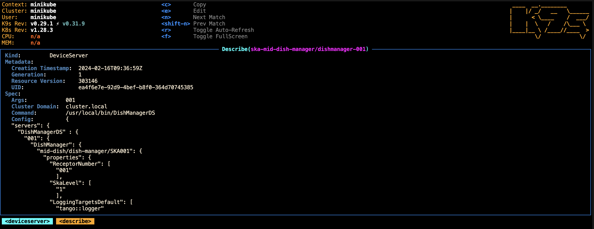

======
How to
======
This page will guide you through the steps to deploying DishManager
along with the simulators locally. It is assumed here that you have cloned the
``ska-mid-dish-manager`` repository, and have `set up your development environment`_. 

Prerequisite: Selecting the dish structure type for Dish Manager to control and monitor
---------------------------------------------------------------------------------------

In all cases where Dish Manager is to be deployed, the dish manager Tango device is 
required to be configured with a dish structure (DS) to control and monitor, regardless 
of whether control and monitoring is setup up for the SPF and SPFRx components or not.

The Dish Manager Tango device is capable of monitoring 2 dish structure variants;

.. list-table:: Dish structure types
   :widths: 33 33 33 33
   :header-rows: 1

   * - Local Monitoring and Control (LMC) deployment type
     - Dish structure controller variant 
     - Dish structure Tango device implementation
     - Dish structure Tango device repository
   * - Dish LMC
     - SKA MID dish structure controller
     - ``DSManager``
     - https://gitlab.com/ska-telescope/mid-dish/ska-mid-dish-ds-manager
   * - MeerKAT LMC
     - MeerKAT antenna positioner (AP)
     - ``MeerKAT AP Manager``
     - https://gitlab.com/ska-telescope/mid-dish/ska-mid-meerkat-lmc 

The dish structure variant selected to be controlled and monitored is driven by the
configuration of the Dish Manager Tango device properties;

* ``DSDeviceFqdn``
* ``APManagerDeviceFqdn``

where only one dish structure type can be monitored by a given Dish Manager instance.

Control and monitoring is setup up for the dish structure variant whose FQDN property is
configured with a valid Tango resource locator (TRL). To disable control and monitoring 
for the other dish structure type, set its respective property to an empty string.

.. note::

   Only one of the above-mentioned properties can be configured at a time.
   Configuring TRLs for both properties presents a conflict that will cause
   the initialization of the Dish Manager Tango device to fail.

If neither property is explicitly configured by the user, the Dish Manager device will 
default to setting up control and monitoring for a DS Manager Tango device instance at 
the TRL ``mid-dish/ds-manager/SKA001``.

Dish Manager control differences when changing dish structure types
^^^^^^^^^^^^^^^^^^^^^^^^^^^^^^^^^^^^^^^^^^^^^^^^^^^^^^^^^^^^^^^^^^^

Interchangability of the 2 dish structure manager variants is enabled by the fact that 
both the ``DSManager`` and ``MeerKATAPManager`` Tango devices expose the same core set of 
attributes and commands, with each manager device implementing its own internal logic
to ensure parity is maintained between the 2 interfaces.

By moving the logical complexity of handling 2 different dish controller types to their
respective manager devices, clients to the Dish Manager Tango device are able to interface
with Dish Manager without having make significant accommodations for each dish type, however,
some minor differences need to be accounted for;

1: **Configuration differences**

Differences in helm deployment configuration are highlighted in detail in the following subsections

2: **TrackTable Azimuth/Elevation (AZ/EL) differences**

The Antenna control unit (ACU) imposes the following AZ/EL limits;

.. list-table:: ACU AZ/EL Limits
   :widths: 50 50
   :header-rows: 1

   * - Parameter
     - Limit (in degrees)
   * - Maximum Elevation 
     - 92.0
   * - Minimum Elevation 
     - 14.5
   * - Maximum Azimuth 
     - 275.0
   * - Minimum Elevation 
     - -185.0
 

which differ from those of the SKA MID dish tabulated below;

.. list-table:: SKA MID Dish structure controller AZ/EL Limits
   :widths: 50 50
   :header-rows: 1

   * - Parameter
     - Limit (in degrees)
   * - Maximum Science Elevation 
     - 85.0
   * - Minimum Science Elevation 
     - 15.0
   * - Maximum Azimuth 
     - 270.0
   * - Minimum Elevation 
     - - 270.0

Deploy DishManager to monitor an SKA MID Dish with Simulators
^^^^^^^^^^^^^^^^^^^^^^^^^^^^^^^^^^^^^^^^^^^^^^^^^^^^^^^^^^^^^

1. Deploy ska-tango-operator to manage the pods and their configuration.

.. tabs::

   .. tab:: ska-tango-operator chart deployment

      .. code-block:: console

        $ git clone git@gitlab.com:ska-telescope/ska-tango-operator.git
        $ cd ska-tango-operator
        $ make k8s-install-chart

2. Deploy ska-mid-dish-manager from the chart

.. tabs::

   .. tab:: ska-mid-dish-manager chart deployment

      .. code-block:: console
        
        $ cd ska-mid-dish-manager
        $ K8S_CHART_PARAMS='--values charts/ska-mid-dish-manager/custom_helm_flags.yaml' make k8s-install-chart
        $ # alternatively, you can use the helm command directly
        $ helm upgrade --install test charts/ska-mid-dish-manager -n dish-manager -f charts/ska-mid-dish-manager/custom_helm_flags.yaml

1. Advanced: Deploy ska-mid-dish-manager from your repository

.. tabs::

   .. tab:: ska-mid-dish-manager as a chart dependency

      Assumption: `templates repository`_ is used to manage your deployment.

      The ska-mid-dish-manager chart can be added as a chart dependency in your own repository
      to include it as part of your own deployment process. This will also require setting some
      additional configuration in your values file.

      .. code-block:: rst
         
         # in chart.yaml
         ...
         - name: ska-mid-dish-manager
         version: x.x.x
         repository: https://artefact.skao.int/repository/helm-internal

         - name: ska-mid-dish-simulators
         version: x.x.x
         repository: https://artefact.skao.int/repository/helm-internal
         condition: ska-mid-dish-simulators.enabled

      .. code-block:: rst
         
         # in your custom values.yaml
         ...
         dishmanager:
            wms:
               station_ids: ["1"]
         ska-mid-dish-simulators:
            enabled: true
            deviceServers:
               spfdevice:
                  enabled: true
               spfrxdevice:
                  enabled: true
            dsOpcuaSimulator:
               enabled: true

         ska-mid-dish-ds-manager:
            enabled: true

         ska-mid-wms:
            enabled: true
            ska-tango-base:
               enabled: false
               itango:
                  enabled: false
            deviceServers:
               wms:
                  enabled: true
                  station_ids: ["1"]
                  modbus_server_hostnames: ["wms-sim-1"]
                  modbus_server_ports: ["1502"]
            simulator:
               enabled: True

      .. note:: Tango DB is not deployed by default, to deploy it add ``--set ska-tango-base.enabled=true``
         if it's not part of your existing deployment. Also, use ``false`` for the global operator
         flag if you're not making use of the ska tango operator in your repository.

The deployment will constitute pods for:

* Tango DB
* DishManager
* DSManager
* Simulators: SPF, SPFRx & OPCUA server
* WeatherMonitoringSystem (WMS) and WMS simulator server 

All these pods have to be up in the ``ska-mid-dish-manager`` namespace to have a
fully functional software to interact. The pod of particular interest will be
``ds-manager-001-0``. The device name which connects to the DishManager server is
``mid-dish/dish-manager/SKA001``: this may change, and can be looked up in the deployment on
the ``deviceserver`` namespace by inspecting the ``Config`` value on the
``dishmanager-001`` pod (see the image below).

Deploy DishManager to monitor a MeerKAT Antenna with Simulators
^^^^^^^^^^^^^^^^^^^^^^^^^^^^^^^^^^^^^^^^^^^^^^^^^^^^^^^^^^^^^^^

1. Deploy ska-tango-operator to manage the pods and their configuration.

.. tabs::

   .. tab:: ska-tango-operator chart deployment

      .. code-block:: console

        $ git clone git@gitlab.com:ska-telescope/ska-tango-operator.git
        $ cd ska-tango-operator
        $ make k8s-install-chart

2. Deploy ska-mid-dish-manager from the chart

.. tabs::

   .. tab:: ska-mid-dish-manager chart deployment

      .. code-block:: console
        
        $ cd ska-mid-dish-manager
        $ # An example custom Helm values file is provided inside the Dish Manager repository  
        $ # showing how control and monitoring is setup for an APManager Tango device instance
        $ helm upgrade --install test charts/ska-mid-dish-manager -n dish-manager -f charts/ska-mid-dish-manager/deployment_with_mk_ap_manager.yaml

1. Advanced: Deploy ska-mid-dish-manager (with an APManager and AP simulator) from your repository

.. tabs::

   .. tab:: ska-mid-dish-manager as a chart dependency

      Assumption: `templates repository`_ is used to manage your deployment.

      The ska-mid-dish-manager chart can be added as a chart dependency in your own repository
      to include it as part of your own deployment process. This will also require setting some
      additional configuration in your values file.

      .. code-block:: rst
         
         # in chart.yaml
         ...
         - name: ska-mid-dish-manager
         version: x.x.x
         repository: https://artefact.skao.int/repository/helm-internal

         - name: ska-mid-dish-simulators
         version: x.x.x
         repository: https://artefact.skao.int/repository/helm-internal
         condition: ska-mid-dish-simulators.enabled

         - name: ska-mid-meerkat-ap-manager
         version: x.x.x
         repository: https://artefact.skao.int/repository/helm-internal
         condition: ska-mid-meerkat-ap-manager.enabled

         - name: ska-mid-meerkat-ap-simulator
         version: x.x.x
         repository: https://artefact.skao.int/repository/helm-internal
         condition: ska-mid-meerkat-ap-simulator.enabled

      .. code-block:: rst
         
         # in your custom values.yaml
         ...    
         ska-mid-dish-simulators:
            enabled: true
            deviceServers:
               spfdevice:
                  enabled: true
               spfrxdevice:
                  enabled: true
            dsOpcuaSimulator:
               enabled: false

         ska-mid-dish-ds-manager:
            enabled: false

         # -----------------------------------------------------------------------------
         # Dish Manager config - Configure the DS TRL to point to an AP Manager instance
         # -----------------------------------------------------------------------------
         dishmanager:
            b5dcproxy:
               monitoring: false
            ds:
               fqdn: ""
               domain_name: ""
               family_name: ""
            ap_manager:
               fqdn: "mid-dish/meerkat-ap-manager/SKA001"
               # Configure the full TRL above OR configure the AP Manager TRL domain and family 
               domain_name: "" 
               family_name: ""

         # -------------------------------------------------
         # MeerKAT AP Manager and AP Simulator configuration
         # -------------------------------------------------
         ska-mid-meerkat-ap-manager:
            enabled: true

            meerkatapmanager:
               enabled: true
      
               # Configure MK AP server instance to connect to
               deviceproperties:
                  katcp_hosts: ["katcp-ap-sim-001-svc"]
                  katcp_ports: [4022]
                  sampling_strategies: []
                  sensors_to_ignore: []

            deviceServers:
               meerkatapmanager:
                  enabled: true

         ska-mid-meerkat-ap-simulator:
            enabled: true
            apSimulator:
               name: katcp-ap-sim
               enabled: true

The deployment will constitute pods for:

* Tango DB
* DishManager
* APManager
* Simulators: SPF, SPFRx & AP simulator server

.. note:: 
   
   Only one dish structure variant can be configured for control and monitoring at a time.
   If a values.yaml configuration is provided that configures the both dish structure
   varients simultaneously the helm deployment will fail as a result of the configuration
   conflict.
   

Manage your Deployment
^^^^^^^^^^^^^^^^^^^^^^
A deployment constitutes a number of running pods, with each deployed pod
exposing a running tango device. kubectl commands can be used to manage your
deployment; however using `k9s`_ to manager your cluster deployment is very
efficient and time saving. Having an additional (sandbox) pod to in the cluster
to drive the control and monitoring is also essential.

There's an `example configuration file`_ which can be used to deploy an
additional pod in the cluster. To use it run the kubectl command below and
itango from the pod's shell.

.. tabs::

   .. tab:: deploy sandbox

      .. code-block:: console
        
        $ kubectl apply -f sandbox.yaml
        $ itango3

The sandbox pod can be killed using ``Ctrl + k``.

.. note:: Deploy DishManager before running itango on the sandbox pod to avoid database connection errors

.. tabs::

   .. tab:: tear down DishManager

      .. code-block:: console
        
        $ cd ska-mid-dish-manager
        $ make k8s-uninstall-chart

   .. tab:: tear down tango operator

      .. code-block:: console
        
        $ cd ska-tango-operator
        $ make k8s-uninstall-chart

.. _set up your development environment: https://developer.skatelescope.org/en/latest/tools/tango-devenv-setup.html
.. _k9s: https://github.com/derailed/k9s
.. _example configuration file: https://gitlab.com/ska-telescope/ska-mid-dish-manager/-/blob/main/charts/sandbox.yaml?ref_type=heads
.. _templates repository: https://gitlab.com/ska-telescope/templates-repository
.. _extra variables: https://gitlab.com/ska-telescope/ska-mid-dish-manager#deploy-the-chart-with-simulators
